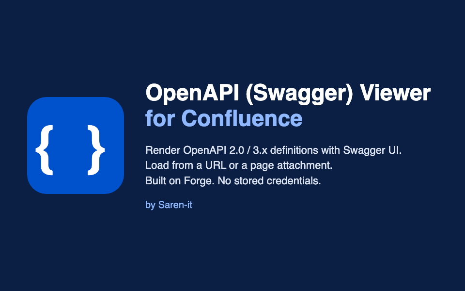
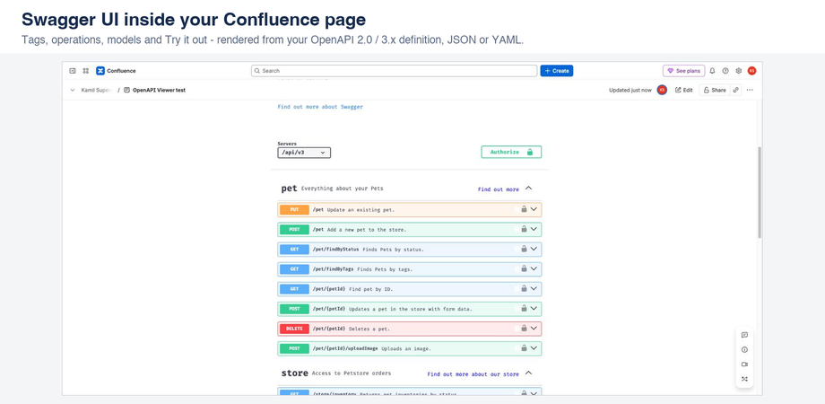
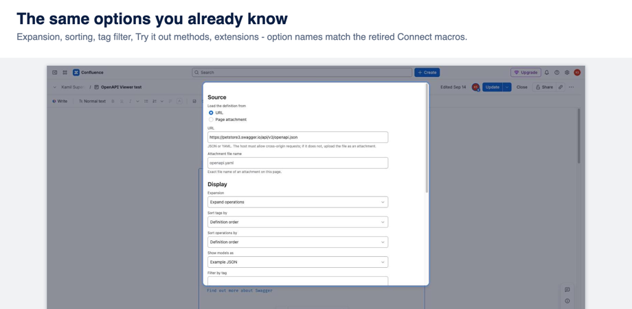
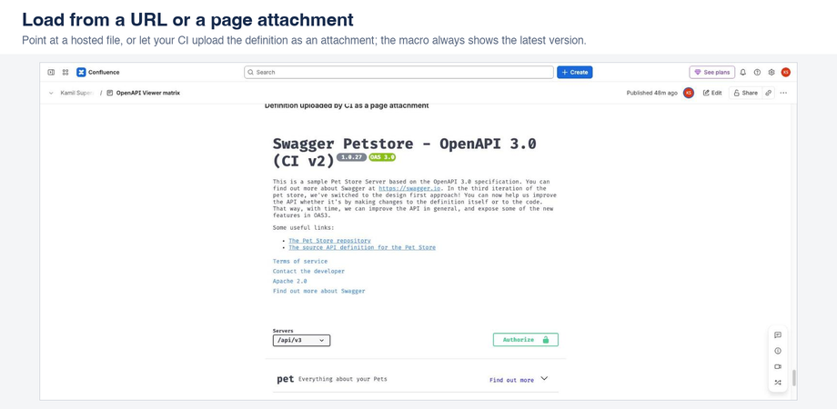

# Saren-it apps for Confluence

- [OpenAPI (Swagger) Viewer](#openapi-swagger-viewer-for-confluence)
- [JSON & YAML Viewer](json-viewer.md)

## OpenAPI (Swagger) Viewer for Confluence

Show your API reference where your team already reads documentation. The macro renders an OpenAPI 2.0 or 3.x definition (JSON or YAML) with Swagger UI, right inside a Confluence Cloud page. Built on Atlassian Forge, no external servers, no stored credentials.

- [Privacy policy](privacy.md)
- [Security](security.md)
- [Support](support.md)
- [Publish from CI](ci.md)

## Getting started

1. Install the app from the Atlassian Marketplace.
2. Edit a Confluence page, type `/OpenAPI` and insert **OpenAPI (Swagger) Viewer**.
3. Choose where the definition comes from: **URL** or **Page attachment**.
4. Adjust display options if needed and save. Publish the page.

## Example 1: a public definition from a URL

Use this when your definition is already published, for example on GitHub, GitHub Pages or your API gateway.

| Setting | Value |
|---|---|
| Load the definition from | URL |
| URL | `https://petstore3.swagger.io/api/v3/openapi.json` |
| Expansion | Expand operations |

The reader's browser downloads the file directly, so the host must allow cross-origin requests (CORS). GitHub raw links, GitHub Pages and most API gateways do. If you see a CORS message, use Example 2.

## Example 2: a private definition as a page attachment

Use this for internal APIs, or when the host does not allow cross-origin requests.

1. Upload `openapi.yaml` to the page (drag the file onto the page, or **⋯ → Attachments**).
2. In the macro, choose **Page attachment** and enter `openapi.yaml`.

| Setting | Value |
|---|---|
| Load the definition from | Page attachment |
| Attachment file name | `openapi.yaml` |

Readers see the definition only if they can view the page. To keep it up to date automatically, let your pipeline upload a new attachment version on every build: see [Publish from CI](ci.md).

## Options

| Option | What it does | Default |
|---|---|---|
| Expansion | Start collapsed, expand operations, or expand operations and details | Start collapsed |
| Sort tags by | Definition order or name | Definition order |
| Sort operations by | Definition order, path or HTTP method | Definition order |
| Show models as | Example JSON or JSON schema | Example JSON |
| Filter by tag | Show only operations with this tag | empty |
| Limit number of tags displayed | Maximum number of tags shown | 50 |
| Supported Try it out methods | Comma-separated methods, for example `get, post`; `none` disables Try it out | none |
| Show request duration | Show how long Try it out requests took | off |
| Online validator URL | Validate the definition with an external validator; empty disables it | empty |
| Show operation ID | Show `operationId` next to each operation | off |
| Show vendor extensions | Show `x-` extensions on operations and parameters | off |
| Show common extensions | Show common JSON Schema extensions such as `pattern` and `maxLength` | off |

## FAQ

**Which formats are supported?** OpenAPI 3.0 and 3.1, and Swagger (OpenAPI) 2.0, in JSON or YAML.

**My API needs a login or token to download the definition.** The app never stores usernames, passwords or tokens. Upload the file as a page attachment instead, or publish it from CI.

**Does "Try it out" send requests from Confluence?** No. When you enable it, requests go from the reader's browser straight to the servers listed in your definition. It is disabled by default.

**Does my definition leave Atlassian?** No. It is rendered in the reader's browser; nothing is sent to us or to third parties. See [Security](security.md).

## Migrating from a Connect-based Swagger macro

Using *Open API (Swagger) Integration*, *Swagger UI for Confluence* or *Open API (Swagger) Editor for Confluence*? Insert OpenAPI (Swagger) Viewer next to the old macro, copy the URL and the same options (names match), remove the old macro.
